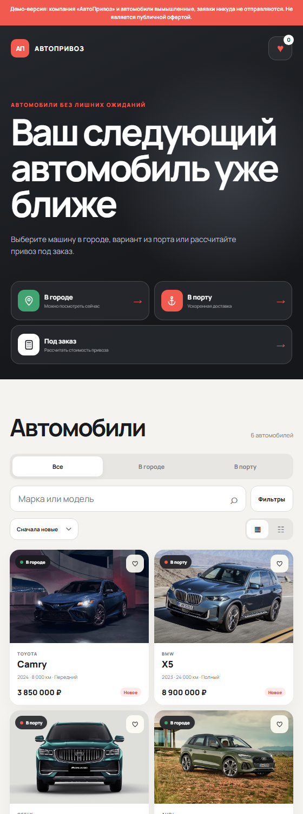
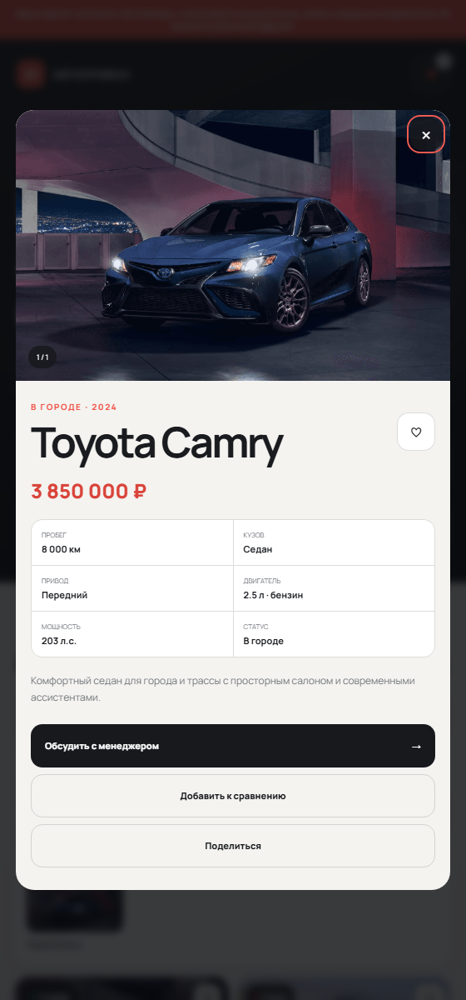
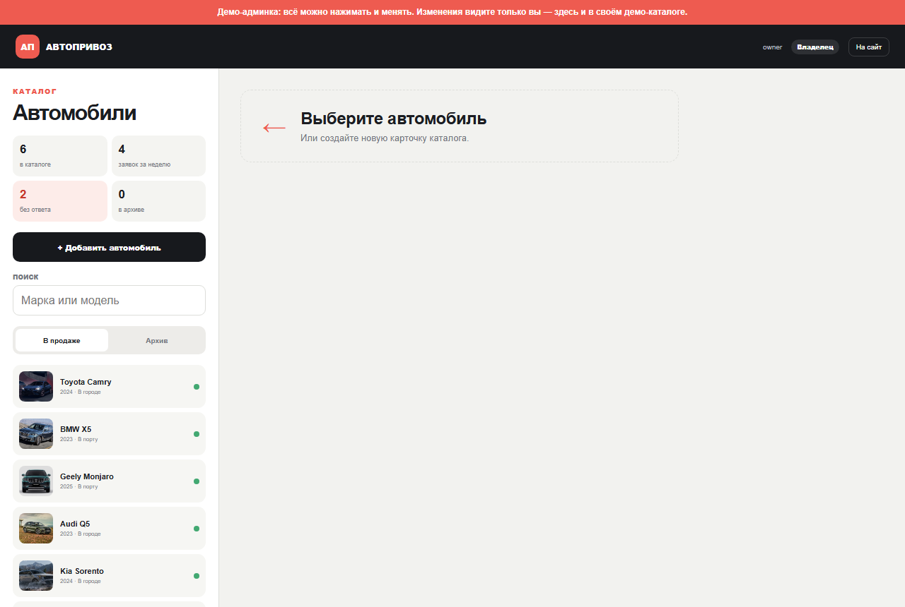

# Autobot — Telegram-боты для автодилера

[](https://github.com/pokorsskiy/autodealer-telegram-bots/actions/workflows/tests.yml)

Четыре Telegram-бота для компании, которая продаёт и привозит автомобили: каталог
с админкой внутри Telegram, калькулятор стоимости привоза, приём заявок. Проект развёрнут
и работает; компания «АвтоПривоз» и автомобили в нём вымышленные.

Попробовать:

| Бот | Что это | Где |
|---|---|---|
| Web App-каталог | Каталог и админка, открываются внутри Telegram | [@primerauto1_bot](https://t.me/primerauto1_bot), [сайт](https://showautobot.ru), [админка без входа](https://showautobot.ru/admin/demo) |
| Telegram-каталог | Калькулятор привоза и заявка в переписке | [@primerauto2_bot](https://t.me/primerauto2_bot) |
| Гибридный бот | Быстрые действия в чате, каталог в Web App | [@primerauto3_bot](https://t.me/primerauto3_bot) |

<p>
  
  
</p>
<p></p>

## Стек

Python 3.10+, pyTelegramBotAPI, Flask, SQLite, gunicorn, nginx, systemd.
Фронтенд каталога и админки — HTML, CSS и JavaScript без сборки и фреймворков.
Тесты — `unittest`, 128 тестов без обращений к Telegram; линтер — ruff; CI — GitHub Actions.

## Как устроено

```
                     ┌─ showcase_bot ─────────── навигатор по примерам
Telegram ◄─ polling ─┼─ showcase_telegram_bot ── калькулятор и заявка в чате
                     ├─ showcase_hybrid_bot ──┐
                     └─ showcase_webapp_bot   │ HTTP, подпись HMAC
                                │             ▼
браузер / Web App ─ nginx ─ gunicorn ─ Flask (webapp/) ─ SQLite, uploads/
```

- Каждый бот — отдельный сервис со своим `.env`, базой и тестами. Общего пакета нет намеренно:
  бот под новую компанию собирается копированием одной папки, поэтому `config`, `logger`
  и калькулятор повторяются.
- Каталог и админка — одно Flask-приложение. Telegram открывает его как Web App,
  но оно работает и в обычном браузере.
- Гибридный бот не имеет своей админки: заявки он передаёт серверу Web App-бота по HTTP.

## Что внутри интересного

Основной код — Web App-бот, [`showcase_webapp_bot/`](showcase_webapp_bot):

```
server.py             точка входа: gunicorn server:app
webapp/               Flask-приложение, собирается фабрикой create_app
  auth.py             сессия, роли, CSRF, подпись Telegram, ограничение попыток входа
  validation.py       проверка карточки, заявки и загружаемого фото
  notifications.py    уведомление менеджеру через Bot API
  public.py           каталог, политика и согласие, приём заявок
  demo.py             именные демо и песочница
  admin_pages.py      вход и страницы админки
  admin_api.py        API админки: заявки, машины, фото, сотрудники
database/             SQLite: соединение, схема и миграции, заявки, машины, учётные записи
config.py             настройки из .env — единственное место, откуда их читает код
```

**Вход по подписи Telegram.** Web App получает от Telegram строку `initData`. Сервер
пересчитывает её HMAC-SHA256 на ключе, выведенном из токена бота, сравнивает через
`hmac.compare_digest` и проверяет срок давности —
[`verify_init_data`](showcase_webapp_bot/webapp/auth.py). Так сотрудник входит
в админку командой `/admin` без пароля, а заявка из каталога привязывается к профилю
покупателя. Сервер принимает подпись нескольких ботов: в ту же админку входят из гибридного.

**Админка.** Роли «менеджер», «владелец» и «разработчик» с разными правами,
CSRF-токен на изменяющих запросах, ограничение числа попыток входа, пароли в виде хеша,
журнал действий, выгрузка заявок в CSV. Загружаемые фото проверяются по сигнатуре файла,
а не по расширению. Ответы идут с Content-Security-Policy без сторонних источников.

**Межсервисные заявки.** Гибридный бот отправляет заявку на `/api/bot/leads` и подписывает
тело запроса своим токеном (HMAC-SHA256 в заголовке). Если сервер недоступен, покупатель
этого не замечает: заявка сохранена у бота и ушла менеджеру.

**Миграции SQLite.** [`init_db`](showcase_webapp_bot/database/schema.py) сверяет колонки таблиц с ожидаемыми, перед изменением схемы
делает копию файла базы и добавляет недостающее без потери данных.

**Персональные данные.** Заявка принимается только с отметкой согласия, время согласия
хранится в базе. Страницы политики и согласия собираются из реквизитов оператора
в `legal.json`. С настройкой `LEAD_NOTIFY_CONTACTS=0` уведомление менеджеру уходит
в Telegram без имени и телефона — контакты видны только в админке.

**Демо-режим.** При `DEMO_MODE=1` формы ничего не сохраняют и показывают образец заявки,
а админка открывается без входа как песочница. В именном демо (`?demo=<имя>`) песочница
лежит на сервере в папке, имя которой — HMAC от личности посетителя: изменения видит
только их автор, через неделю они удаляются.

**Калькулятор.** Пошлина по единым ставкам ЕАЭС в зависимости от возраста, цены и объёма
двигателя — [`calculator.py`](showcase_telegram_bot/calculator.py). Обратная задача,
«какую машину можно купить на этот бюджет», решается двоичным поиском: пошлина зависит
от цены, и вычесть расходы из бюджета напрямую нельзя.

**Журналы без токенов.** Библиотека кладёт в текст ошибки адрес запроса вместе с токеном
бота. Фильтр `TokenMaskFilter` вырезает его из сообщений и трассировок.

**Посредник к Telegram.** Адрес Bot API берётся из настройки `TELEGRAM_API_URL`:
с сервера, откуда `api.telegram.org` недоступен, бот работает через обратный прокси.

## Запуск

```bash
git clone https://github.com/pokorsskiy/autodealer-telegram-bots.git
cd autodealer-telegram-bots
python -m venv venv
venv/bin/pip install -r requirements.txt        # Windows: venv\Scripts\pip
```

Проще всего начать с каталога: ему не нужен ни бот, ни Telegram.

```bash
cd showcase_webapp_bot
cp .env.example .env
```

В `.env` задайте `DEMO_MODE=1`, любой `BOT_TOKEN`, `SECRET_KEY` длиной от 32 символов,
`ADMIN_PASSWORD` от 12 символов и `SESSION_COOKIE_SECURE=0` для работы по HTTP. Затем:

```bash
python server.py
```

Каталог откроется на http://127.0.0.1:8000, админка-песочница — на
http://127.0.0.1:8000/admin/demo.

Боты запускаются так же, каждый из своей папки, с настоящим токеном от
[@BotFather](https://t.me/BotFather): `python bot.py`. Настройки описаны в README бота:
[витрина](showcase_bot/README.md), [Telegram-каталог](showcase_telegram_bot/README.md),
[Web App-каталог](showcase_webapp_bot/README.md), [гибрид](showcase_hybrid_bot/README.md).

## Тесты и линтер

```bash
pip install -r requirements-dev.txt
ruff check .
cd showcase_webapp_bot && python -m unittest
```

Тесты запускаются из папки бота. Они не ходят в сеть: Telegram заменён заглушками,
база создаётся во временной папке.

## Развёртывание

Образец конфигурации сервера — в [`deploy/`](deploy/README.md): nginx с HTTPS, юниты systemd,
ежедневные резервные копии SQLite, обновление одной командой.

## Лицензия

[MIT](LICENSE)
